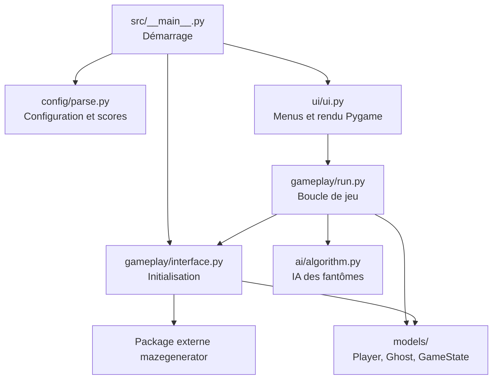

*This project has been created as part of the 42 curriculum by cpietrza, elarue.*

**Langue :** [English](README.md) | **Français**

# Pacman-42

**Un jeu Pac-Man en Python, avec quatre comportements de fantômes distincts, des niveaux générés procéduralement et une interface Pygame.**

Pacman-42 est un projet en équipe réalisé dans le cadre du cursus de 42. L'objectif est de reproduire les mécaniques principales du jeu d'arcade classique tout en concevant une application Python modulaire : labyrinthe généré par une bibliothèque externe, fantômes autonomes, Pac-Gums et Super Pac-Gums, règles configurables, interface graphique et meilleurs scores persistants.

## Aperçu du gameplay


## Sommaire

- [Description](#description)
- [Fonctionnalités](#fonctionnalités)
- [Installation et lancement](#installation-et-lancement)
- [Commandes du jeu](#commandes-du-jeu)
- [Configuration](#configuration)
- [Système de meilleurs scores](#système-de-meilleurs-scores)
- [Génération des labyrinthes](#génération-des-labyrinthes)
- [Implémentation](#implémentation)
- [Architecture logicielle générale](#architecture-logicielle-générale)
- [Packaging et distribution](#packaging-et-distribution)
- [Gestion de projet](#gestion-de-projet)
- [Limites connues](#limites-connues)
- [Ressources et utilisation de l'IA](#ressources-et-utilisation-de-lia)

## Description

Le joueur parcourt un labyrinthe, ramasse des Pac-Gums, évite les fantômes et utilise les Super Pac-Gums pour prendre temporairement l'avantage. Un niveau est terminé lorsque toutes les Pac-Gums et Super Pac-Gums restantes ont été ramassées. Le jeu est conçu autour de **10 niveaux configurables**, avec un premier labyrinthe reproductible et des labyrinthes générés procéduralement pour les niveaux suivants.

L'interface graphique repose sur **Pygame**. Les entités et l'état du jeu sont représentés par des classes Python, les données de configuration et de score sont validées avec **Pydantic**, et les déplacements des fantômes combinent **une recherche en largeur (BFS)** et d'autres stratégies. Les labyrinthes sont fournis par le **package externe A-Maze-ing imposé par le sujet**, et non par un générateur développé pour ce projet.

Le jeu relie la progression automatique des niveaux, les écrans de victoire et de défaite, la saisie du nom et la sauvegarde des scores. Le dépôt contient également un script de packaging pour Linux et macOS, ainsi que des preuves de gestion de projet. Les problèmes restants figurent dans les [Limites connues](#limites-connues).

## Fonctionnalités

- Labyrinthes procéduraux générés par le package `mazegenerator` fourni.
- Dix configurations de niveaux, avec une seed fixe pour le premier niveau et des labyrinthes aléatoires ensuite.
- Quatre fantômes placés dans les coins du labyrinthe, chacun ayant une stratégie de déplacement différente.
- Pac-Gums, Super Pac-Gums dans les coins, points, collisions et vies.
- États des fantômes : normal, effrayé (*frightened*) et mort/en cours de retour.
- Déplacements au clavier avec les flèches ou les touches WASD.
- Menu principal Pygame, affichage du jeu, HUD, pause et écrans de victoire/défaite.
- Progression automatique entre les niveaux en conservant le score et les vies restantes.
- Saisie du nom après victoire ou défaite, sauvegarde des scores et classement des dix meilleurs accessible depuis le menu principal.
- Paramètres configurables dans un fichier JSON acceptant également les commentaires `#` sur une ligne entière.
- Commandes de triche pour l'évaluation : traversée des murs, invincibilité et saut de niveau.
- Validation des enregistrements de scores et gestion des fichiers de scores absents ou incorrects.
- Packaging natif Linux ou macOS avec PyInstaller via `make build`, comprenant les ressources graphiques, les instructions pour les joueurs et une archive ZIP.

> **Déroulement :** menu principal → niveaux successifs → victoire ou défaite → saisie du nom et validation avec Entrée → sauvegarde du score → menu principal.

## Installation et lancement

### Prérequis

Pour le développement, installe :

- **Python 3.12 ou une version supérieure** (le projet déclare `>=3.12`).
- **uv** pour gérer l'environnement et les dépendances.
- Un environnement graphique compatible avec Pygame.

Le dépôt contient la dépendance fournie `mazegenerator-2.1.0-py3-none-any.whl`. Installe le projet depuis la racine du dépôt afin qu'`uv` retrouve ce fichier local.

### Installation et exécution depuis les sources

```bash
git clone https://github.com/Chrisnox-209/Pacman-42.git
cd Pacman-42
make install
make run
```

`make install` exécute `uv sync`. `make run` démarre l'application avec le fichier `config.json` du dépôt :

```bash
uv run python -m src config.json
```

Tu peux utiliser un autre fichier de configuration en appelant directement le module :

```bash
uv run python -m src my-config.json
```

Le projet déclare également une commande Python nommée `pacman-42` :

```bash
uv run pacman-42 config.json
```

**En mode sources/CLI, un argument correspondant au fichier de configuration est obligatoire.** Si ce fichier est absent ou contient du JSON incorrect, le chargeur est conçu pour utiliser les valeurs par défaut en affichant un avertissement explicatif.

### Autres commandes du Makefile

| Commande | Fonction |
| --- | --- |
| `make install` | Synchronise les dépendances du projet. |
| `make run` ou `make` | Lance le jeu depuis les sources avec `config.json`. |
| `make lint` | Exécute mypy et flake8. |
| `make lint-strict` | Lance les vérifications strictes configurées. |
| `make debug` | Exécute `uv run python3 -m pdb -m src $(CONFIG)` ; saisir `c` dans le débogueur pour continuer. |
| `make clean` | Supprime les caches de développement et l'environnement virtuel. |
| `make build` | Construit l'exécutable natif et crée une archive ZIP Linux ou macOS. |

## Commandes du jeu

| Touche | Action |
| --- | --- |
| `↑` / `↓` | Monter ou descendre dans le menu principal. |
| `Entrée` | Sélectionner une option, reprendre après une pause ou valider le nom pour sauvegarder le score final. |
| `Retour arrière` | Effacer le dernier caractère pendant la saisie du nom. |
| `↑` `↓` `←` `→` / `W` `A` `S` `D` | Déplacer Pac-Man. |
| `Échap` | Mettre le jeu en pause ; depuis la pause, retourner au menu principal. |
| `Q` | Quitter pendant la partie ou depuis la pause. |
| `C` | Afficher ou masquer les informations sur les commandes de triche. |
| `N` | Activer ou désactiver la traversée des murs (*noclip*, dans les limites du labyrinthe). |
| `I` | Activer ou désactiver l'invincibilité face aux fantômes à l'état normal. |
| `L` | Demander le passage au niveau suivant. |

Les commandes de triche servent à faciliter les tests demandés lors de l'évaluation ; elles ne font pas partie du mode de jeu compétitif normal.

### Règles du jeu

- Ramasse les Pac-Gums pour gagner des points et nettoyer le labyrinthe.
- Ramasse une Super Pac-Gum pour marquer des points et effrayer temporairement les fantômes vulnérables.
- Toucher un fantôme normal fait perdre une vie ; la partie se termine lorsque le joueur n'a plus de vies.
- Manger un fantôme effrayé rapporte des points et le renvoie vers son coin d'apparition.
- Ramasse toutes les Pac-Gums et Super Pac-Gums pour démarrer automatiquement le niveau suivant, en conservant le score et les vies restantes.
- Termine le dernier niveau pour afficher `VICTORY`, `Congratulations!` et le score final.
- Après une victoire ou une défaite, saisis un nom et appuie sur Entrée pour sauvegarder le score et revenir au menu principal.
- Le HUD affiche le score, les vies, le niveau et le temps restant.

## Configuration

Le fichier de configuration principal en développement est [`config.json`](config.json). Son format est JSON avec la possibilité d'ajouter des **commentaires occupant une ligne entière et commençant par `#`**. Le parseur actuel ne prend pas en charge les commentaires en fin de ligne.

```jsonc
{
  # Les lignes commençant par # sont ignorées par le chargeur du jeu.
  "highscore_filename": "scores.json",
  "lives": 3,
  "pacgum": 42,
  "speed_player": 40,
  "speed_ghosts": 25,
  "points_per_pacgum": 10,
  "points_per_super_pacgum": 50,
  "points_per_ghost": 200,
  "time_respawn_ghost": 3,
  "seed": 42,
  "perfect": false
}
```

La clé `levels` peut être omise pour utiliser les dix niveaux intégrés par défaut. Lorsqu'elle est fournie, le parseur attend **au moins dix objets de niveau**, chacun contenant `width`, `height`, `escape_time` et `level_max_time`. Exemple :

```json
{"width": 20, "height": 20, "escape_time": 6, "level_max_time": 90}
```

### Référence des paramètres

La colonne **Valeur par défaut** correspond aux valeurs utilisées par `ParseConfig()` lorsqu’un paramètre est absent ou remplacé par sa valeur de secours. La colonne **`config.json` du dépôt** représente le fichier versionné ; les modifications locales de test peuvent différer.

| Clé | Valeur par défaut | `config.json` du dépôt | Description |
| --- | --- | --- | --- |
| `highscore_filename` | `scores.json` | `scores.json` | Chemin du fichier JSON des meilleurs scores. |
| `levels` | 10 niveaux prédéfinis | 10 niveaux configurés | Dimensions des labyrinthes, durée du mode effrayé et temps limite par niveau. |
| `lives` | `3` | `3` | Nombre de vies au départ. |
| `speed_player` | `100` | `40` | Vitesse du joueur, de 1 à 100 % de la vitesse de base. |
| `speed_ghosts` | `90` | `25` | Vitesse des fantômes, de 1 à 100 % de la vitesse de base. |
| `time_respawn_ghost` | `3` | `3` | Temps d'attente en secondes avant la réactivation d'un fantôme mangé. |
| `pacgum` | `100` | `42` | Pourcentage des cases admissibles contenant une Pac-Gum normale. |
| `points_per_pacgum` | `1` | `10` | Points gagnés avec une Pac-Gum. |
| `points_per_super_pacgum` | `10` | `50` | Points gagnés avec une Super Pac-Gum. |
| `points_per_ghost` | `15` | `200` | Points gagnés en mangeant un fantôme effrayé. |
| `seed` | `42` | `42` | Seed de génération reproductible du premier niveau. |
| `levels[].level_max_time` | `90` pour chaque niveau par défaut | `90` à `145` | Temps limite en secondes, propre à chaque niveau ; plage autorisée : 90–180. |
| `perfect` | `false` | `false` | Paramètre transmis au générateur externe, conservé à `false` pour le sujet. |

Les vitesses utilisent une base de **10 cases par seconde** : `100` correspond à 10 cases/s, `40` à 4 cases/s et `25` à 2,5 cases/s. Ce sont des cadences visées ; la cadence réelle dépend de la boucle de jeu.

Les dimensions des niveaux intégrés vont de **20×20** à **40×20**. La durée du mode effrayé est définie par `escape_time` pour chaque niveau. Elle vaut actuellement **0 seconde au niveau 10** : les super-gommes rapportent des points, mais leur effet de vulnérabilité expire immédiatement.

`level_max_time` se place dans chaque objet de niveau, et non à la racine. La partie se termine lorsque le temps restant atteint zéro.

Les champs inconnus sont ignorés par Pydantic. Les valeurs manquantes ou invalides sont traitées par la validation et les valeurs de remplacement du parseur ; certaines combinaisons incorrectes de niveaux ou de paramètres réinitialisent actuellement l'ensemble de la configuration, plutôt que le seul champ concerné.

## Système de meilleurs scores

Les meilleurs scores sont enregistrés dans un fichier JSON comprenant les noms des joueurs et des scores entiers positifs ou nuls :

```json
{
  "highscore": [
    {"name_player": "PLAYER1", "score": 1250},
    {"name_player": "PLAYER2", "score": 900}
  ]
}
```

Le format est vérifié par les modèles `ParseScore` et `ParseHighScore` du fichier `src/config/parse.py` :

- Les noms des joueurs doivent contenir **entre 1 et 10 caractères**, parmi les lettres, les chiffres et les espaces.
- Les scores doivent être des **entiers positifs ou nuls**.
- La liste de meilleurs scores contient **au maximum 10 entrées**.
- Depuis les sources, un fichier manquant charge une liste vide en mémoire et est créé lors de la première sauvegarde réussie. L'exécutable packagé crée le fichier manquant avec un classement vide au démarrage, sans afficher d'avertissement.
- Un fichier vide ou mal formé est pris en charge sans faire planter le chargeur.

Le chemin vient de `highscore_filename` (normalement `scores.json`). Depuis les sources, les chemins relatifs sont résolus depuis le dossier de travail courant ; les chemins absolus sont utilisés tels quels. L'exécutable packagé utilise uniquement le nom du fichier de ce paramètre et le place à côté de l'exécutable, par exemple `Pacman-42/scores.json`. Le chargement et la sauvegarde utilisent ce même fichier, quel que soit le dossier depuis lequel le jeu est lancé.

Un nom de fichier invalide ou un échec de préparation du dossier des scores déclenche un avertissement et un retour à `scores.json`. Dans le jeu packagé, ce fichier de secours reste également à côté de l'exécutable.

**Pourquoi JSON ?** Ce format est lisible, facile à vérifier pendant une évaluation, cohérent avec la configuration et ne nécessite aucun service de base de données.

Au démarrage, le jeu charge les scores existants. Après une victoire ou une défaite, le joueur saisit un nom de **10 caractères maximum : lettres ASCII, chiffres et espaces**. Retour arrière efface un caractère ; Entrée valide un nom non vide après suppression des espaces en début et fin.

`save_highscore()` ajoute le score final, trie les résultats du plus grand au plus petit et conserve les dix meilleurs. La fonction écrit un fichier temporaire à côté du fichier des scores, puis remplace celui-ci après une écriture réussie. Le classement en mémoire est actualisé et le joueur revient au menu principal.

Si la sauvegarde échoue, le jeu reste sur l’écran de fin et affiche `Save failed. ENTER: retry`. Le menu **Highscores** affiche les dix meilleurs scores chargés ou actualisés, ou un message si la liste est vide.

## Génération des labyrinthes

Les labyrinthes sont générés par le package Python externe A-Maze-ing fourni dans le dépôt sous le nom `mazegenerator-2.1.0-py3-none-any.whl`.

`src/gameplay/interface.py` construit le labyrinthe avec `MazeGenerator(size=(width, height), perfect=False, ...)` puis utilise sa représentation `.maze`. Le projet emploie le package **tel qu'il est fourni**, sans modifier le générateur.

- **Niveau 1 :** utilise la seed configurée (`42` par défaut) pour reproduire le même labyrinthe avec les mêmes paramètres.
- **Niveaux suivants :** aucune seed fixe n'est transmise, permettant d'obtenir des labyrinthes différents.
- **Apparition du joueur :** au centre ou près du centre du labyrinthe, sur une case accessible.
- **Apparition des fantômes :** dans les quatre coins du labyrinthe.
- **Super Pac-Gums :** placées dans les quatre coins.
- **Pac-Gums normales :** réparties aléatoirement parmi les cases admissibles, selon le pourcentage `pacgum`.

Les cellules du labyrinthe codent les murs avec des bits directionnels ; la recherche de chemin respecte les passages ainsi définis. `perfect=False` correspond au mode requis par le sujet Pacman-42.

## Implémentation

### Intelligence artificielle des fantômes

Les quatre fantômes ont des stratégies différentes :

| Fantôme | Stratégie | Implémentation |
| --- | --- | --- |
| **Athos** | Poursuite directe | Suit le plus court chemin avec BFS. |
| **Porthos** | Anticipation | Choisit une cible accessible à proximité du joueur, puis utilise BFS. |
| **Aramis** | Déplacement errant | Choisit aléatoirement une direction disponible en évitant, si possible, de faire immédiatement demi-tour. |
| **Dartagnan** | Imprévisibilité | Poursuit généralement le joueur par BFS, mais choisit parfois une case voisine au hasard (70 % de poursuite, 30 % d'aléatoire). |

BFS est implémenté dans `src/ai/algorithm.py` à l'aide d'une file et d'une table des prédécesseurs, puis reconstruit le chemin en remontant de la cible au départ. En mode effrayé, les fantômes choisissent un mouvement disponible qui tend à éviter le joueur et les retours immédiats en arrière. Les fantômes mangés empruntent un chemin vers leur coin d'apparition avant d'être réactivés.

### Boucle de jeu et score

`src/gameplay/run.py` met à jour les déplacements, les collisions, la collecte des Pac-Gums, le temps du mode effrayé, la réapparition des fantômes, les conditions de fin de niveau et l'affichage. `src/gameplay/interface.py` initialise les niveaux et gère les mouvements du joueur. `Player`, `Ghost` et `GameState` représentent les entités et l'état de la partie.

### Interface graphique

L'interface Pygame est répartie entre cinq modules :

- `src/ui/ui.py` relie la boucle de jeu aux menus, aux animations, à la saisie du nom et à la sauvegarde en fin de partie.
- `src/ui/window.py` gère la fenêtre, les entrées pendant le jeu, les commandes de triche et la pause/reprise.
- `src/ui/screens.py` dessine les menus, les instructions, les meilleurs scores et les écrans de victoire/défaite, et gère la navigation dans les menus.
- `src/ui/drawing.py` dessine le texte bitmap, le labyrinthe, les personnages, le HUD et le panneau de triche.
- `src/ui/resources.py` charge les polices et les sprites depuis `assets/font/` et `assets/geometric/`, et calcule les dimensions d'affichage.

## Architecture logicielle générale

```text
Pacman-42/
├── .packaging/
│   └── INSTRUCTIONS.txt       # Instructions incluses dans l'archive
├── assets/
│   ├── font/                  # Atlas des polices bitmap
│   ├── geometric/             # Sprites Pac-Man, fantômes et Pac-Gums
│   └── gameplay.gif           # Enregistrement du gameplay
├── project-management/        # Exports d'issues, contributions et répartition
├── src/
│   ├── __main__.py            # CLI et démarrage
│   ├── ai/
│   │   └── algorithm.py       # BFS et stratégies des fantômes
│   ├── common/
│   │   └── utils.py           # Fonctions partagées, labyrinthe et Pac-Gums
│   ├── config/
│   │   └── parse.py           # Modèles Pydantic et chargement JSON
│   ├── gameplay/
│   │   ├── interface.py       # Initialisation des niveaux et déplacements
│   │   └── run.py             # Boucle de jeu, collisions et points
│   ├── models/
│   │   ├── game.py            # Player et GameState
│   │   └── ghost.py           # Modèle des fantômes
│   └── ui/
│       ├── drawing.py         # Texte, labyrinthe, entités, HUD et triche
│       ├── resources.py       # Polices, sprites et dimensions d'affichage
│       ├── screens.py         # Menus, informations et écrans de fin
│       ├── ui.py              # Navigation et liaison avec la boucle de jeu
│       └── window.py          # Fenêtre, entrées et gestion de la pause
├── build.sh                   # Packaging de l'exécutable natif et du ZIP
├── Makefile                   # Commandes de développement et de build
├── config.json               # Configuration de développement
├── pyproject.toml            # Métadonnées et dépendances
└── mazegenerator-2.1.0-py3-none-any.whl
```

**Relations entre les composants :**



Cette organisation permet de développer séparément l'intelligence du jeu, les règles du jeu, les modèles de données, la configuration et l'interface graphique, tout en définissant des échanges explicites entre les modules.

## Packaging et distribution

Le packaging Linux et macOS utilise le script [`build.sh`](build.sh) à la racine et la cible `make build`. Le script synchronise les dépendances avec `uv sync` et installe **PyInstaller 6.22.3 comme outil de construction** dans `.venv` ; PyInstaller n'est pas une dépendance d'exécution du jeu. La construction nécessite également la commande `zip`.

Depuis la racine du dépôt, sur le système cible, Linux ou macOS :

```bash
make build
```

Le script construit l'exécutable, intègre les ressources graphiques, copie les [instructions pour les joueurs](.packaging/INSTRUCTIONS.txt) et crée l'archive de distribution :

```text
dist/
├── Pacman-42/
│   ├── Pacman-42        # Exécutable natif
│   ├── INSTRUCTIONS.txt # Instructions pour les joueurs
│   └── _internal/       # Interpréteur, bibliothèques et assets intégrés
└── Pacman-42-<platform>.zip # Archive Linux ou macOS
```

L'archive s'appelle `Pacman-42-Linux.zip` sur Linux ou `Pacman-42-macOS.zip` sur macOS.

Lance l'exécutable **sans fichier de configuration** pour utiliser les valeurs par défaut de `ParseConfig()` :

```bash
./dist/Pacman-42/Pacman-42
```

Ou indique explicitement un fichier de configuration JSON :

```bash
./dist/Pacman-42/Pacman-42 config.json
```

Cette commande suppose que le terminal se trouve à la racine du dépôt. Depuis un autre dossier, tu peux fournir le chemin absolu vers le fichier de configuration.

L'archive ne contient pas `config.json`. Pour utiliser des réglages personnalisés après extraction, place ton fichier de configuration dans le dossier `Pacman-42/` extrait et lance `./Pacman-42 config.json`, ou fournis un chemin absolu. Sans argument, l'exécutable utilise les valeurs internes décrites dans [Configuration](#configuration), notamment les vitesses joueur/fantômes de `100`/`90`, contre `40`/`25` dans le `config.json` du dépôt.

L'exécutable correspond au système d'exploitation et à l'architecture utilisés pour le construire. Pour créer le paquet macOS, lance `make build` sur un Mac ; une construction Linux ne peut pas être exécutée directement sur macOS. Cela correspond au [fonctionnement de PyInstaller par plateforme](https://pyinstaller.org/en/stable/operating-mode.html). Le script prend en charge Linux et macOS ; le packaging Windows n'est pas inclus.

Pour distribuer le jeu, utilise l'archive produite par `make build` pour le système du joueur. Les joueurs doivent extraire l'archive complète et conserver `_internal/` à côté de l'exécutable ; le fichier `INSTRUCTIONS.txt` inclus décrit le lancement, les commandes et la configuration personnalisée.

Teste l'archive après extraction sur une autre machine utilisant le système cible avant de la publier. Le paquet macOS doit être construit et testé sur un Mac. Le sujet demande une **version gratuite, privée ou non répertoriée**, sur itch.io ou une plateforme comparable. Aucun lien de téléchargement sur une plateforme n'est actuellement documenté dans ce dépôt.

## Gestion de projet

Le projet est développé par une équipe de deux personnes. Le travail est réparti entre différentes branches, notamment `ALGO`, `UI` et `PACKAGING`, avec `main` comme branche d'intégration. Les commits Git et les opérations de fusion gardent une trace des modifications de la logique du jeu, de l'interface graphique et des outils de distribution.

Le [dossier de preuves de gestion de projet](project-management/) contient :

- Le [suivi des issues](project-management/ISSUES.md) : un tableau de 37 issues avec leur état, leurs responsables et leurs dates de création et de clôture.
- Un [export des issues](project-management/issues.json) : descriptions, labels, affectations et dates.
- Des captures GitHub et des synthèses visuelles des contributions, de l'état des issues et de la répartition du travail.

Ces fichiers documentent le suivi des tâches et l'organisation de l'équipe. Les résultats des tests d'acceptation, les décisions techniques et les blocages importants peuvent être consignés à côté de ces éléments pour expliquer comment l'équipe a validé le jeu livré.

## Limites connues

1. Le panneau de triche recouvre actuellement le HUD.
2. La taille des cases dépend de l’écran, sans ajustement au nombre de colonnes du niveau ; les grands labyrinthes peuvent dépasser sur certains formats d’écran.
3. `render_text()` assemble encore les lettres dans une image intermédiaire ; l’affichage direct des lettres reste à intégrer dans le cadre du travail sur les équivalents MLX.
4. Certaines valeurs incorrectes réinitialisent toute la configuration au lieu du seul paramètre concerné.
5. Aucun lien de téléchargement sur une plateforme de jeu n'est encore documenté ; chaque archive distribuée doit encore être validée sur une autre machine utilisant le système cible.

## Ressources et utilisation de l'IA

### Documentation et références techniques

- [Documentation Python](https://docs.python.org/3/) — langage Python, typage et bibliothèque standard.
- [Documentation Pygame](https://www.pygame.org/docs/) — graphismes, événements clavier et affichage.
- [Documentation Pydantic](https://docs.pydantic.dev/latest/) — modèles typés et validation des configurations.
- [Documentation PyInstaller](https://pyinstaller.org/en/stable/) — création d'exécutables.
- [Documentation uv](https://docs.astral.sh/uv/) — dépendances et environnements Python.
- [Recherche en largeur (BFS)](https://fr.wikipedia.org/wiki/Algorithme_de_parcours_en_largeur) — principe de recherche de chemin utilisé pour les fantômes.
- **Sujet officiel Pacman de 42** — exigences relatives au gameplay, au packaging, à la documentation et à la gestion de projet.
- **Distribution A-Maze-ing fournie** — `mazegenerator-2.1.0-py3-none-any.whl`, intégrée sans modification du générateur.

### Utilisation de l'intelligence artificielle

**ChatGPT** a servi d'outil d'accompagnement pour comprendre des concepts de Python et d'algorithmique, analyser des erreurs d'importation et de configuration, examiner les procédures Git et de packaging, ainsi que préparer la documentation technique, notamment ce README.

**Claude** a également servi à la génération des assets graphiques du jeu. Un outil intégré de génération d'images a servi à créer les designs géométriques originaux des sprites, leurs variantes directionnelles ont ensuite été produites par symétrie ou rotation.
