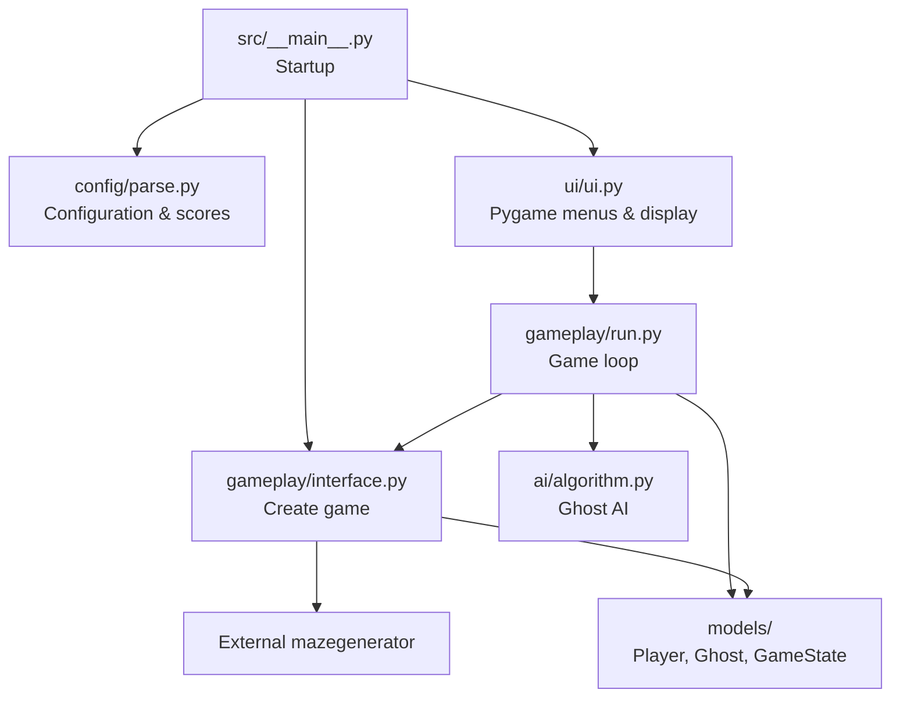

*This project has been created as part of the 42 curriculum by cpietrza, elarue.*

**Language:** **English** | [Français](README.fr.md)

# Pacman-42

**A maze-based Pac-Man game in Python, with four distinct ghost behaviors, procedurally generated levels, and a Pygame interface.**

Pacman-42 is a team project developed for the 42 curriculum. The goal is to reproduce the core gameplay of the arcade classic while designing a modular Python application: an externally generated maze, autonomous ghosts, Pac-Gums and Super Pac-Gums, configurable rules, a graphical interface, and persistent highscores.

## Gameplay Preview


## Table of Contents

- [Description](#description)
- [Features](#features)
- [Instructions](#instructions)
- [Controls](#controls)
- [Configuration](#configuration)
- [Highscore System](#highscore-system)
- [Maze Generation](#maze-generation)
- [Implementation](#implementation)
- [General Software Architecture](#general-software-architecture)
- [Packaging and Distribution](#packaging-and-distribution)
- [Project Management](#project-management)
- [Known Limitations](#known-limitations)
- [Resources and AI Usage](#resources-and-ai-usage)

## Description

The player navigates a maze, collects Pac-Gums, avoids ghosts, and uses Super Pac-Gums to temporarily turn the tables. A level is cleared by collecting the remaining Pac-Gums and Super Pac-Gums. The game is designed around **10 configurable levels**, with a deterministic first maze and procedurally generated subsequent mazes.

The graphical frontend is written in **Pygame**. Game entities and state are represented by Python classes, configuration and score data are validated using **Pydantic**, and ghost movement uses **breadth-first search (BFS)** alongside other movement strategies. Mazes are provided by the **assigned external A-Maze-ing package**, not by a generator developed for this project.

The game connects automatic level progression, victory and defeat screens, player-name entry, and persistent highscores. The repository also includes a packaging script for Linux and macOS, and project-management evidence. Remaining issues are listed under [Known Limitations](#known-limitations).

## Features

- Procedural mazes based on the assigned `mazegenerator` package.
- Ten level definitions, including a fixed-seed first level and random later levels.
- Four ghosts spawning in the maze corners, each with a different movement strategy.
- Pac-Gums, corner Super Pac-Gums, score updates, collisions, and lives.
- Normal, frightened, and returning/dead ghost states.
- Keyboard movement using arrow keys or WASD.
- Pygame main menu, game display, HUD, pause screen, and victory/defeat screens.
- Automatic level progression with score and remaining lives carried over.
- Player-name entry after victory or defeat, saved scores, and a top-ten ranking accessible from the main menu.
- Configurable game parameters loaded from a JSON file that also supports full-line `#` comments.
- Evaluation-oriented cheat controls for noclip, invincibility, and level skipping.
- Input validation for highscore records and recovery from missing or malformed score files.
- Native Linux or macOS packaging with PyInstaller through `make build`, including assets, player instructions, and a ZIP archive.

> **Game flow:** Main menu → play successive levels → victory or defeat → enter a name and confirm with Enter → save the score → main menu.

## Instructions

### Requirements

For development, install:

- **Python 3.12 or later** (the project declares `>=3.12`).
- **uv** to manage the environment and dependencies.
- A supported desktop environment capable of running Pygame.

The repository includes the assigned `mazegenerator-2.1.0-py3-none-any.whl` dependency. Install the project from the repository root so that `uv` can find this local wheel.

### Install and run from source

```bash
git clone https://github.com/Chrisnox-209/Pacman-42.git
cd Pacman-42
make install
make run
```

`make install` runs `uv sync`. `make run` executes the application with the repository's `config.json`:

```bash
uv run python -m src config.json
```

You can provide another configuration file by calling the module directly:

```bash
uv run python -m src my-config.json
```

The installed command-line entry point is also defined as `pacman-42`:

```bash
uv run pacman-42 config.json
```

**Source/CLI usage requires one configuration-file argument.** If the file is missing or has malformed JSON, the loader is designed to fall back to defaults with an explanatory warning.

### Other Makefile commands

| Command | Purpose |
| --- | --- |
| `make install` | Synchronize project dependencies. |
| `make run` or `make` | Launch the source game using `config.json`. |
| `make lint` | Run mypy and flake8. |
| `make lint-strict` | Run the stricter configured checks. |
| `make debug` | Run `uv run python3 -m pdb -m src $(CONFIG)`; type `c` at the debugger prompt to continue. |
| `make clean` | Remove development caches and the virtual environment. |
| `make build` | Build the native executable and create a Linux or macOS ZIP archive. |

## Controls

| Key | Action |
| --- | --- |
| `↑` / `↓` | Navigate up/down through the main menu. |
| `Enter` | Select a menu item, resume from pause, or confirm a name and save the final score. |
| `Backspace` | Delete the last character while entering a name. |
| `↑` `↓` `←` `→` / `W` `A` `S` `D` | Move Pac-Man. |
| `Esc` | Pause during gameplay; from the pause screen, return to the main menu. |
| `Q` | Quit during gameplay or from the pause screen. |
| `C` | Toggle the on-screen cheat-control information. |
| `N` | Toggle noclip (ignore maze walls, within the maze bounds). |
| `I` | Toggle invincibility to normal-state ghosts. |
| `L` | Request the next level. |

Cheat controls are provided to help evaluators exercise game features; they are not part of normal competitive play.

### Game rules

- Eat Pac-Gums to earn points and clear the maze.
- Eat a Super Pac-Gum to earn points and temporarily frighten vulnerable ghosts.
- Touching a normal ghost costs one life; reaching zero lives ends the run.
- Eating a frightened ghost awards points and sends it back toward its spawn corner.
- Collect all Pac-Gums and Super Pac-Gums to start the next level automatically, keeping the score and remaining lives.
- Complete the final level to display `VICTORY`, `Congratulations!`, and the final score.
- After victory or defeat, enter a name and press Enter to save the score and return to the main menu.
- The HUD shows score, lives, current level, and remaining time.

## Configuration

The main development configuration is [`config.json`](config.json). Its format is JSON with optional **full-line comments beginning with `#`**. Inline comments are not supported by the current parser.

```jsonc
{
  # Lines beginning with # are ignored by the game's config loader.
  "highscore_filename": "scores.json",
  "lives": 3,
  "pacgum": 42,
  "speed_player": 40,
  "speed_ghosts": 25,
  "points_per_pacgum": 10,
  "points_per_super_pacgum": 50,
  "points_per_ghost": 200,
  "time_respawn_ghost": 3,
  "seed": 42,
  "perfect": false
}
```

The `levels` key may be omitted to use the built-in list of ten levels. If supplied, the parser expects **at least ten** level objects, each containing `width`, `height`, `escape_time`, and `level_max_time`, for example:

```json
{"width": 20, "height": 20, "escape_time": 6, "level_max_time": 90}
```

### Configuration reference

The **built-in default** is the value used by `ParseConfig()` when a setting is omitted or replaced by its fallback. The **tracked file** column describes the versioned `config.json`; local test edits may differ.

| Key | Built-in default | Tracked `config.json` | Description |
| --- | --- | --- | --- |
| `highscore_filename` | `scores.json` | `scores.json` | Path to highscore JSON data. |
| `levels` | 10 predefined levels | 10 configured levels | Maze dimensions, frightened duration, and time limit for each level. |
| `lives` | `3` | `3` | Starting lives. |
| `speed_player` | `100` | `40` | Player speed, from 1 to 100% of the base speed. |
| `speed_ghosts` | `90` | `25` | Ghost speed, from 1 to 100% of the base speed. |
| `time_respawn_ghost` | `3` | `3` | Delay in seconds before an eaten ghost becomes active again at its corner. |
| `pacgum` | `100` | `42` | Percentage of eligible cells receiving a regular Pac-Gum. |
| `points_per_pacgum` | `1` | `10` | Points for a regular Pac-Gum. |
| `points_per_super_pacgum` | `10` | `50` | Points for a Super Pac-Gum. |
| `points_per_ghost` | `15` | `200` | Points for eating a frightened ghost. |
| `seed` | `42` | `42` | Reproducible maze seed for level 1. |
| `levels[].level_max_time` | `90` for each default level | `90` to `145` | Time limit in seconds, configured separately for each level; accepted range: 90–180. |
| `perfect` | `false` | `false` | Passed to the external maze generator; kept `false` for the assignment. |

Speeds use a base of **10 cells per second**: `100` means 10 cells/s, `40` means 4 cells/s, and `25` means 2.5 cells/s. These are target movement rates; actual timing depends on the game loop.

The built-in level dimensions range from **20×20** to **40×20**. Frightened duration is configured separately with `escape_time`. It is currently **0 seconds at level 10**, so power pellets award points but their frightened effect expires immediately.

`level_max_time` belongs inside each level object, not at the root. Reaching zero remaining time ends the game.

Unrecognized fields are ignored by Pydantic. Invalid or missing configuration values are handled by the parser's validation and fallback logic; some invalid level/settings combinations currently reset the whole configuration rather than only the affected field.

## Highscore System

Highscores use a JSON file with player names and non-negative integer scores:

```json
{
  "highscore": [
    {"name_player": "PLAYER1", "score": 1250},
    {"name_player": "PLAYER2", "score": 900}
  ]
}
```

The format is validated by `ParseScore` and `ParseHighScore` in `src/config/parse.py`:

- Player names must be **1–10 characters**, using letters, numbers, and spaces.
- Scores must be **non-negative integers**.
- The highscore collection must contain **no more than 10 entries**.
- In source runs, a missing file loads an empty list in memory and is created when a score is successfully saved. The packaged executable creates a missing file with an empty ranking at startup, without displaying a warning.
- An empty or malformed file is handled without crashing the loader.

The file path comes from `highscore_filename` (normally `scores.json`). In source runs, relative paths are resolved from the current working directory; absolute paths are used as provided. The packaged executable uses only the filename from this setting and stores it beside the executable, for example `Pacman-42/scores.json`. Loading and saving use that same file, regardless of the directory from which the game is launched.

Invalid filenames or failures to prepare the configured score directory fall back to `scores.json` with a warning. In the packaged game, this fallback also stays beside the executable.

**Why JSON?** It is readable, easy to inspect during peer review, integrates with the configuration approach, and does not require a database service.

At startup, the game loads existing scores. After a win or loss, the player enters a name of up to **10 ASCII letters, digits, or spaces**. Backspace deletes a character; Enter confirms a nonblank name, with surrounding spaces removed.

`save_highscore()` adds the final score, sorts the entries in descending order, and keeps only the best ten. It writes a temporary file next to the score file, then replaces the score file after a successful write. The in-memory ranking is updated and the player returns to the main menu.

If saving fails, the game stays on the end screen and displays `Save failed. ENTER: retry`. The **Highscores** menu displays the loaded or updated top ten, or a message when there are no scores.

## Maze Generation

The maze is generated by the externally assigned A-Maze-ing Python package distributed in this repository as `mazegenerator-2.1.0-py3-none-any.whl`.

`src/gameplay/interface.py` creates the maze with `MazeGenerator(size=(width, height), perfect=False, ...)` and reads its `.maze` representation. The project uses the package **as supplied**, without modifying its generator.

- **Level 1:** uses the configured seed (`42` by default), producing the same maze for repeated runs with the same parameters.
- **Later levels:** do not pass a fixed seed, allowing different mazes.
- **Player spawn:** chosen at, or near, the center of the maze on an accessible cell.
- **Ghost spawns:** the four corners of the maze.
- **Super Pac-Gums:** placed in the four corners.
- **Regular Pac-Gums:** sampled from eligible, non-reserved cells using the `pacgum` percentage.

Maze cells encode walls as directional bit flags; pathfinding respects the resulting corridor connections. `perfect=False` is the required mode for the Pac-Man assignment.

## Implementation

### Ghost AI

Four named ghosts use different strategies:

| Ghost | Strategy | Implementation |
| --- | --- | --- |
| **Athos** | Direct pursuit | Shortest-path pursuit using BFS. |
| **Porthos** | Anticipation | Selects a reachable target near the player, then uses BFS. |
| **Aramis** | Wandering | Chooses randomized available directions, avoiding immediate reversal where possible. |
| **Dartagnan** | Unpredictability | Usually chases via BFS, but sometimes chooses a random neighbor (70% chase / 30% random). |

BFS is implemented in `src/ai/algorithm.py` with a queue and a predecessor table, then reconstructs the path from the target back to the start. During frightened mode, ghosts choose an available move that tends to avoid the player and immediate backtracking. Eaten ghosts follow a path to their spawn corner and later reactivate.

### Game loop and scoring

`src/gameplay/run.py` updates movement, collisions, Pac-Gum collection, frightened-mode timing, ghost respawning, level checks, and drawing. `src/gameplay/interface.py` initializes a new level and handles player movement. `Player`, `Ghost`, and `GameState` hold the active entities and game state.

### Graphical interface

The Pygame frontend is split across five modules:

- `src/ui/ui.py` connects the game loop to the menus, animation, and end-of-game name entry and score saving.
- `src/ui/window.py` manages the window, gameplay input, cheat toggles, and pause/resume handling.
- `src/ui/screens.py` draws menus, instructions, highscores, and victory/defeat screens, and handles menu navigation.
- `src/ui/drawing.py` draws bitmap text, the maze, characters, HUD, and cheat panel.
- `src/ui/resources.py` loads fonts and sprites from `assets/font/` and `assets/geometric/`, and computes display dimensions.

## General Software Architecture

```text
Pacman-42/
├── .packaging/
│   └── INSTRUCTIONS.txt       # Player instructions included in the archive
├── assets/
│   ├── font/                  # Bitmap font atlases
│   ├── geometric/             # Pac-Man, ghost and pellet sprites
│   └── gameplay.gif           # Gameplay recording
├── project-management/        # Issue exports, contributions and task allocation
├── src/
│   ├── __main__.py            # CLI and startup
│   ├── ai/
│   │   └── algorithm.py       # BFS and ghost movement strategies
│   ├── common/
│   │   └── utils.py           # Maze, pellet and shared helpers
│   ├── config/
│   │   └── parse.py           # Pydantic models and JSON loading
│   ├── gameplay/
│   │   ├── interface.py       # Game/level initialization, player movement
│   │   └── run.py             # Update loop, collisions, scoring
│   ├── models/
│   │   ├── game.py            # Player and GameState
│   │   └── ghost.py           # Ghost model
│   └── ui/
│       ├── drawing.py         # Text, maze, entities, HUD and cheat panel
│       ├── resources.py       # Fonts, sprites and display dimensions
│       ├── screens.py         # Menus, information and end screens
│       ├── ui.py              # UI flow and connection to the game loop
│       └── window.py          # Window, gameplay input and pause handling
├── build.sh                   # Native executable and ZIP packaging
├── Makefile                   # Common development/build commands
├── config.json               # Development configuration
├── pyproject.toml            # Project metadata and dependencies
└── mazegenerator-2.1.0-py3-none-any.whl
```

**Runtime relationship:**



The separation lets the team develop ghost AI, game rules, models, configuration, and the graphical frontend independently while exposing well-defined interfaces between them.

## Packaging and Distribution

The Linux and macOS packaging workflow uses the root-level [`build.sh`](build.sh) script and the `make build` target. The script synchronizes project dependencies with `uv sync` and installs **PyInstaller 6.22.3 as a build tool** in `.venv`; PyInstaller is not a runtime dependency of the game. The build also requires the `zip` command.

Build on the target system, Linux or macOS, from the repository root:

```bash
make build
```

The script builds the executable, bundles the assets, copies [player instructions](.packaging/INSTRUCTIONS.txt), and creates the distribution archive:

```text
dist/
├── Pacman-42/
│   ├── Pacman-42        # Native executable
│   ├── INSTRUCTIONS.txt # Player instructions
│   └── _internal/       # Embedded interpreter, libraries and assets
└── Pacman-42-<platform>.zip # Linux or macOS distribution archive
```

The archive is named `Pacman-42-Linux.zip` on Linux or `Pacman-42-macOS.zip` on macOS.

Launch the executable **without a configuration file** to use `ParseConfig()` defaults:

```bash
./dist/Pacman-42/Pacman-42
```

Or explicitly provide a JSON configuration file:

```bash
./dist/Pacman-42/Pacman-42 config.json
```

The above example assumes your current directory is the repository root. You can provide an absolute configuration path when launching from elsewhere.

The archive does not include `config.json`. To use custom settings after extraction, place your configuration file in the extracted `Pacman-42/` directory and run `./Pacman-42 config.json`, or provide an absolute path. Without an argument, the executable uses the built-in defaults documented in [Configuration](#configuration), including player/ghost speeds of `100`/`90`, compared with `40`/`25` in the repository's `config.json`.

The executable targets the operating system and architecture used to build it. To create the macOS package, run `make build` on a Mac; a Linux build cannot run directly on macOS. This follows [PyInstaller's platform-specific build model](https://pyinstaller.org/en/stable/operating-mode.html). The script supports Linux and macOS; Windows packaging is not included.

For distribution, use the archive generated by `make build` for the player's system. Players must extract the complete archive and keep `_internal/` alongside the executable; the included `INSTRUCTIONS.txt` describes launching, controls, and custom configuration.

Test the extracted archive on another machine with the target operating system before distribution. The macOS package must be built and tested on a Mac. The project subject calls for a **free, unlisted/private release** on itch.io or a comparable gaming platform. No platform download link is currently documented in this repository.

## Project Management

The project is developed by a two-person team. Work is separated across development branches such as `ALGO`, `UI`, and `PACKAGING`, with `main` as the integration branch. Git commits and pull/merge workflows record changes to gameplay logic, interface code, and distribution tooling.

The [project-management evidence directory](project-management/) contains:

- [Issue tracking](project-management/ISSUES.md): a table of 37 issues with status, assignees, and creation/closure dates.
- [Issue export](project-management/issues.json): issue descriptions, labels, assignments, and timestamps.
- GitHub screenshots and visual summaries of contributions, issue status, and task allocation.

These files document task tracking and team organization. Acceptance-test results, technical decisions, and significant blockers can be recorded alongside these artifacts to explain how the team validated the delivered game.

## Known Limitations

1. The cheat panel currently covers the HUD.
2. Cell size follows the screen size without accounting for each level’s column count; large mazes may exceed some screen formats.
3. `render_text()` still composes letters into an intermediate image; direct character drawing remains part of the MLX-equivalence work.
4. Some invalid settings reset the whole configuration instead of just the affected field.
5. A gaming-platform download link is not yet documented; each distributed archive still needs validation on another machine with its target operating system.

## Resources and AI Usage

### Documentation and technical references

- [Python documentation](https://docs.python.org/3/) — Python language, typing and standard library.
- [Pygame documentation](https://www.pygame.org/docs/) — graphics, input events and rendering.
- [Pydantic documentation](https://docs.pydantic.dev/latest/) — typed models and configuration validation.
- [PyInstaller documentation](https://pyinstaller.org/en/stable/) — executable packaging.
- [uv documentation](https://docs.astral.sh/uv/) — Python dependency and environment management.
- [Breadth-first search](https://en.wikipedia.org/wiki/Breadth-first_search) — pathfinding concept used for ghost movement.
- **42 Pacman project subject** — assignment requirements for gameplay, packaging, documentation, and project management.
- **Assigned A-Maze-ing distribution** — `mazegenerator-2.1.0-py3-none-any.whl`, integrated without modifying its generator.

### Use of artificial intelligence

**ChatGPT** was used as a support tool for understanding Python and algorithm concepts, discussing and debugging import/configuration problems, reviewing Git and packaging workflows, and preparing technical documentation, including this README.

**Claude** was also used to generate graphical assets for the game. An integrated image-generation tool was used to create the original geometric sprite designs; direction variants were then derived by mirroring or rotating those images.
