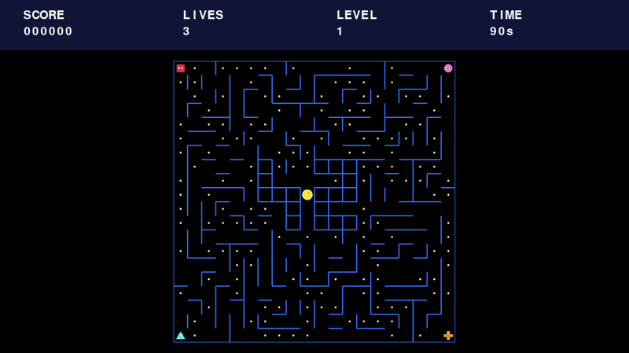
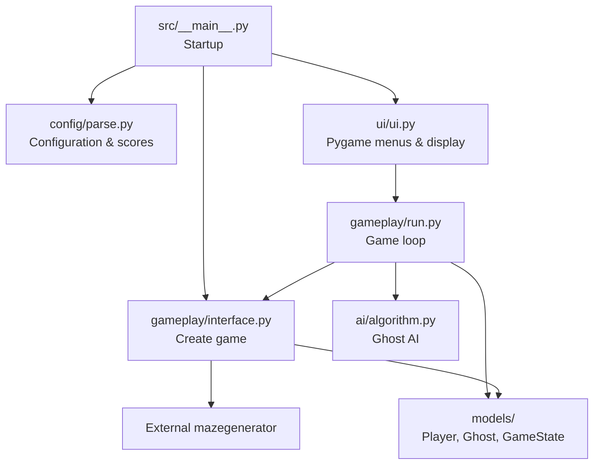

*This project has been created as part of the 42 curriculum by cpietrza, elarue.*

**Language:** **English** | [Français](README.fr.md)

# Pacman-42

**A maze-based Pac-Man game in Python, with four distinct ghost behaviors, procedurally generated levels, and a Pygame interface.**

Pacman-42 is a team project developed for the 42 curriculum. The goal is to reproduce the core gameplay of the arcade classic while designing a modular Python application: an externally generated maze, autonomous ghosts, Pac-Gums and Super Pac-Gums, configurable rules, a graphical interface, and persistent highscores.

## Gameplay Preview



> **GIF placeholder:** Add your own recording as `assets/gameplay.gif` to display it above on GitHub. Keep the clip short and optimized for quick loading.

## Table of Contents

- [Description](#description)
- [Features](#features)
- [Instructions](#instructions)
- [Controls](#controls)
- [Configuration](#configuration)
- [Highscore System](#highscore-system)
- [Maze Generation](#maze-generation)
- [Implementation](#implementation)
- [General Software Architecture](#general-software-architecture)
- [Packaging and Distribution](#packaging-and-distribution)
- [Project Management](#project-management)
- [Known Limitations](#known-limitations)
- [Resources and AI Usage](#resources-and-ai-usage)

## Description

The player navigates a maze, collects Pac-Gums, avoids ghosts, and uses Super Pac-Gums to temporarily turn the tables. A level is cleared by collecting the remaining Pac-Gums and Super Pac-Gums. The game is designed around **10 configurable levels**, with a deterministic first maze and procedurally generated subsequent mazes.

The graphical frontend is written in **Pygame**. Game entities and state are represented by Python classes, configuration and score data are validated using **Pydantic**, and ghost movement uses **breadth-first search (BFS)** alongside other movement strategies. Mazes are provided by the **assigned external A-Maze-ing package**, not by a generator developed for this project.

The repository contains a working gameplay foundation and a Linux packaging workflow. Some end-to-end UI features required by the subject are still being integrated; see [Known Limitations](#known-limitations).

## Features

- Procedural mazes based on the assigned `mazegenerator` package.
- Ten level definitions, including a fixed-seed first level and random later levels.
- Four ghosts spawning in the maze corners, each with a different movement strategy.
- Pac-Gums, corner Super Pac-Gums, score updates, collisions, and lives.
- Normal, frightened, and returning/dead ghost states.
- Keyboard movement using arrow keys or WASD.
- Pygame main menu, game display, HUD, pause screen, and game-over screen.
- Configurable game parameters loaded from a JSON file that also supports full-line `#` comments.
- Evaluation-oriented cheat controls for noclip, invincibility, and level skipping.
- Input validation for highscore records and recovery from missing or malformed score files.
- Linux executable generation through PyInstaller and `make build`.

> **Integration status:** The top-10 highscore display and persistence of new scores, automatic progression between levels, and a dedicated victory screen are not yet fully connected in the reviewed revision.

## Instructions

### Requirements

For development, install:

- **Python 3.12 or later** (the project declares `>=3.12`).
- **uv** to manage the environment and dependencies.
- A supported desktop environment capable of running Pygame.

The repository includes the assigned `mazegenerator-2.1.0-py3-none-any.whl` dependency. Install the project from the repository root so that `uv` can find this local wheel.

### Install and run from source

```bash
git clone https://github.com/Chrisnox-209/Pacman-42.git
cd Pacman-42
make install
make run
```

`make install` runs `uv sync`. `make run` executes the application with the repository's `config.json`:

```bash
uv run python -m src config.json
```

You can provide another configuration file by calling the module directly:

```bash
uv run python -m src my-config.json
```

The installed command-line entry point is also defined as `pacman-42`:

```bash
uv run pacman-42 config.json
```

**Source/CLI usage requires one configuration-file argument.** If the file is missing or has malformed JSON, the loader is designed to fall back to defaults with an explanatory warning.

### Other Makefile commands

| Command | Purpose |
| --- | --- |
| `make install` | Synchronize project dependencies. |
| `make run` or `make` | Launch the source game using `config.json`. |
| `make lint` | Run mypy and flake8. |
| `make lint-strict` | Run the stricter configured checks. |
| `make debug` | Start the debugger; its current recipe needs the configuration argument to be added. |
| `make build` | Build the Linux executable with PyInstaller. |
| `make clean` | Remove development caches and the virtual environment. |
| `make clean-package` | Remove generated packaging artifacts. |
| `make clean-all` | Run the broader project and package cleanup. |

## Controls

| Key | Action |
| --- | --- |
| `↑` / `↓` | Navigate up/down through the main menu. |
| `Enter` | Select a menu item or resume from pause. |
| `↑` `↓` `←` `→` / `W` `A` `S` `D` | Move Pac-Man. |
| `Esc` | Pause during gameplay; from the pause screen, return to the main menu. |
| `Q` | Quit during gameplay or from the pause screen. |
| `C` | Toggle the on-screen cheat-control information. |
| `N` | Toggle noclip (ignore maze walls, within the maze bounds). |
| `I` | Toggle invincibility to normal-state ghosts. |
| `L` | Request the next level. |

Cheat controls are provided to help evaluators exercise game features; they are not part of normal competitive play.

### Game rules

- Eat Pac-Gums to earn points and clear the maze.
- Eat a Super Pac-Gum to earn points and temporarily frighten vulnerable ghosts.
- Touching a normal ghost costs one life; reaching zero lives ends the run.
- Eating a frightened ghost awards points and sends it back toward its spawn corner.
- Complete all configured levels to win; the current version still requires UI integration for correct level-to-level transitions.
- The HUD shows score, lives, current level, and remaining time.

## Configuration

The main development configuration is [`config.json`](config.json). Its format is JSON with optional **full-line comments beginning with `#`**. Inline comments are not supported by the current parser.

```jsonc
{
  # Lines beginning with # are ignored by the game's config loader.
  "highscore_filename": "scores.json",
  "lives": 3,
  "pacgum": 42,
  "speed_player": 10,
  "speed_ghosts": 9,
  "points_per_pacgum": 10,
  "points_per_super_pacgum": 50,
  "points_per_ghost": 200,
  "time_respawn_ghost": 3,
  "seed": 42,
  "level_max_time": 90,
  "perfect": false
}
```

The `levels` key may be omitted to use the built-in list of ten levels. If supplied, the current parser expects **at least ten** level objects, each containing `width`, `height`, and `escape_time`, for example:

```json
{"width": 20, "height": 20, "escape_time": 6}
```

### Configuration reference

The **built-in default** is the value used by `ParseConfig()` and by the packaged executable when launched without arguments. The **tracked file** column describes the current repository's `config.json`; it contains some development/test values.

| Key | Built-in default | Tracked `config.json` | Description |
| --- | --- | --- | --- |
| `highscore_filename` | `scores.json` | `scores.json` | Path to highscore JSON data. |
| `levels` | 10 predefined levels | 10 configured levels | Maze dimensions and frightened duration for each level. |
| `lives` | `3` | `3` | Starting lives. |
| `speed_player` | `10` | `10` | Configured player-movement rate. |
| `speed_ghosts` | `9` | `1` | Configured ghost-movement rate. |
| `time_respawn_ghost` | `3` | `3` | Delay in seconds before an eaten ghost becomes active again at its corner. |
| `pacgum` | `100` | `1` | Percentage of eligible cells receiving a regular Pac-Gum. |
| `points_per_pacgum` | `1` | `10` | Points for a regular Pac-Gum. |
| `points_per_super_pacgum` | `10` | `50` | Points for a Super Pac-Gum. |
| `points_per_ghost` | `15` | `200` | Points for eating a frightened ghost. |
| `seed` | `42` | `42` | Reproducible maze seed for level 1. |
| `level_max_time` | `90` | `90` | Time limit for each level, in seconds. |
| `perfect` | `false` | `false` | Passed to the external maze generator; kept `false` for the assignment. |

The built-in level dimensions range from **20×20** to **40×20**. Frightened-mode duration is configured separately for each level, declining to **0 seconds at level 10** to reproduce late-game Pac-Man behavior. This zero duration is intentional.

Unrecognized fields are ignored by Pydantic. Invalid or missing configuration values are handled by the parser's validation and fallback logic; some invalid level/settings combinations currently reset the whole configuration rather than only the affected field.

## Highscore System

Highscores use a JSON file with player names and non-negative integer scores:

```json
{
  "highscore": [
    {"name_player": "PLAYER1", "score": 1250},
    {"name_player": "PLAYER2", "score": 900}
  ]
}
```

The format is validated by `ParseScore` and `ParseHighScore` in `src/config/parse.py`:

- Player names must be **1–10 characters**, using letters, numbers, and spaces.
- Scores must be **non-negative integers**.
- The highscore collection must contain **no more than 10 entries**.
- A missing file is initialized with an empty highscore list.
- An empty or malformed file is handled without crashing the loader.

In source mode, the file path comes from `highscore_filename` in the configuration. In the **packaged executable**, a relative score filename is resolved inside `~/.pacman-42/` on Linux, so the saved data is independent of the application directory. Absolute paths provided in the configuration are preserved.

**Why JSON?** It is readable, easy to inspect during peer review, integrates with the configuration approach, and does not require a database service.

**Current implementation status:** Loading and validating records are implemented, but the reviewed version does **not yet write the new final score at game end, sort and retain the best ten scores, or display stored entries on the Highscores screen**. These connections must be finished before the final evaluation.

## Maze Generation

The maze is generated by the externally assigned A-Maze-ing Python package distributed in this repository as `mazegenerator-2.1.0-py3-none-any.whl`.

`src/gameplay/interface.py` creates the maze with `MazeGenerator(size=(width, height), perfect=False, ...)` and reads its `.maze` representation. The project uses the package **as supplied**, without modifying its generator.

- **Level 1:** uses the configured seed (`42` by default), producing the same maze for repeated runs with the same parameters.
- **Later levels:** do not pass a fixed seed, allowing different mazes.
- **Player spawn:** chosen at, or near, the center of the maze on an accessible cell.
- **Ghost spawns:** the four corners of the maze.
- **Super Pac-Gums:** placed in the four corners.
- **Regular Pac-Gums:** sampled from eligible, non-reserved cells using the `pacgum` percentage.

Maze cells encode walls as directional bit flags; pathfinding respects the resulting corridor connections. `perfect=False` is the required mode for the Pac-Man assignment.

## Implementation

### Ghost AI

Four named ghosts use different strategies:

| Ghost | Strategy | Implementation |
| --- | --- | --- |
| **Athos** | Direct pursuit | Shortest-path pursuit using BFS. |
| **Porthos** | Anticipation | Selects a reachable target near the player, then uses BFS. |
| **Aramis** | Wandering | Chooses randomized available directions, avoiding immediate reversal where possible. |
| **Dartagnan** | Unpredictability | Usually chases via BFS, but sometimes chooses a random neighbor (70% chase / 30% random). |

BFS is implemented in `src/ai/algorithm.py` with a queue and a predecessor table, then reconstructs the path from the target back to the start. During frightened mode, ghosts choose an available move that tends to avoid the player and immediate backtracking. Eaten ghosts follow a path to their spawn corner and later reactivate.

### Game loop and scoring

`src/gameplay/run.py` updates movement, collisions, Pac-Gum collection, frightened-mode timing, ghost respawning, level checks, and drawing. `src/gameplay/interface.py` initializes a new level and handles player movement. `Player`, `Ghost`, and `GameState` hold the active entities and game state.

### Graphical interface

`src/ui/ui.py` uses Pygame for the main menu, sprite and font loading, the heads-up display, animation, input handling, and pause/game-over screens. Art assets are loaded from `assets/font/` and `assets/geometric/`. `src/ui/maze.py` also contains an earlier terminal-oriented renderer, but the main entry point uses the Pygame frontend.

## General Software Architecture

```text
Pacman-42/
├── assets/
│   ├── font/                  # Bitmap font atlases
│   ├── geometric/             # Pac-Man, ghost and pellet sprites
│   └── gameplay.gif           # Add your gameplay recording here
├── src/
│   ├── __main__.py            # CLI and startup
│   ├── ai/
│   │   └── algorithm.py       # BFS and ghost movement strategies
│   ├── common/
│   │   └── utils.py           # Maze, pellet and shared helpers
│   ├── config/
│   │   └── parse.py           # Pydantic models and JSON loading
│   ├── gameplay/
│   │   ├── interface.py       # Game/level initialization, player movement
│   │   └── run.py             # Update loop, collisions, scoring
│   ├── models/
│   │   ├── game.py            # Player and GameState
│   │   └── ghost.py           # Ghost model
│   └── ui/
│       ├── ui.py              # Pygame presentation and input
│       └── maze.py            # Terminal-oriented renderer
├── build.sh                   # PyInstaller build script
├── Makefile                   # Common development/build commands
├── config.json               # Development configuration
├── pyproject.toml            # Project metadata and dependencies
└── mazegenerator-2.1.0-py3-none-any.whl
```

**Runtime relationship:**



The separation lets the team develop ghost AI, game rules, models, configuration, and the graphical frontend independently while exposing well-defined interfaces between them.

## Packaging and Distribution

The `PACKAGING` branch introduces a Linux PyInstaller workflow through [`build.sh`](build.sh). PyInstaller is installed **only as a build tool** by the script; it is not declared as a runtime dependency of the game.

Build on Linux from the repository root:

```bash
make build
```

The script installs the required build tool in the local virtual environment and generates:

```text
dist/
└── Pacman-42/
    ├── Pacman-42        # Linux executable
    └── _internal/       # Embedded interpreter, libraries and assets
```

Launch the executable **without a configuration file** to use `ParseConfig()` defaults:

```bash
./dist/Pacman-42/Pacman-42
```

Or explicitly provide a JSON configuration file:

```bash
./dist/Pacman-42/Pacman-42 config.json
```

The above example assumes your current directory is the repository root. You can provide an absolute configuration path when launching from elsewhere.

The executable was built for **Linux**. PyInstaller does not cross-compile Windows executables from Linux; a Windows `.exe` must be built in a Windows environment.

For distribution, archive the entire `dist/Pacman-42/` directory, including `_internal/`, and add short instructions for players. For example, on a system with `zip` installed:

```bash
cd dist
zip -r -y Pacman-42-Linux.zip Pacman-42/
```

Test the extracted archive on another Linux machine before distribution. The project subject calls for a **free, unlisted/private release** on itch.io or a comparable gaming platform. A release link will be added when publication is complete.

## Project Management

The project is developed by a two-person team. Work is separated across development branches such as `ALGO`, `UI`, and `PACKAGING`, with `main` as the integration branch. Git commits and pull/merge workflows record changes to gameplay logic, interface code, and distribution tooling.

The 42 subject additionally requires a dedicated [project-management evidence directory](docs/project-management/) containing a timeline or Kanban board, progress tracking, risk analysis, work distribution, acceptance tests, and significant blockers. **The linked directory does not exist in the reviewed repository yet and must be created and populated before submission.**

## Known Limitations

The following items were identified during review of the `PACKAGING` branch and must not be mistaken for completed features:

1. The highscore screen currently shows placeholder text rather than the loaded top ten scores.
2. Player-name entry is collected at game over, but there is no connected save-and-rank step for the final score.
3. Level completion increments the level counter in the gameplay loop, but the surrounding UI currently routes the return from `run()` to the game-over screen rather than automatically starting the next level.
4. A distinct congratulatory victory screen has not yet been connected.
5. The debug Makefile target currently does not pass the required configuration-file argument.
6. Packaging still needs end-to-end testing from an extracted archive, player instructions, and the actual itch.io publication.
7. The requested project-management documentation directory is not yet in the repository.

These notes describe the reviewed code revision, not the final intended feature set.

## Resources and AI Usage

### Documentation and technical references

- [Python documentation](https://docs.python.org/3/) — Python language, typing and standard library.
- [Pygame documentation](https://www.pygame.org/docs/) — graphics, input events and rendering.
- [Pydantic documentation](https://docs.pydantic.dev/latest/) — typed models and configuration validation.
- [PyInstaller documentation](https://pyinstaller.org/en/stable/) — executable packaging.
- [uv documentation](https://docs.astral.sh/uv/) — Python dependency and environment management.
- [Breadth-first search](https://en.wikipedia.org/wiki/Breadth-first_search) — pathfinding concept used for ghost movement.
- **42 Pacman project subject** — assignment requirements for gameplay, packaging, documentation, and project management.
- **Assigned A-Maze-ing distribution** — `mazegenerator-2.1.0-py3-none-any.whl`, integrated without modifying its generator.

### Use of artificial intelligence

**ChatGPT** was used as a support tool for understanding Python and algorithm concepts, discussing and debugging import/configuration problems, reviewing Git and packaging workflows, and preparing technical documentation, including this README. An integrated image-generation tool was also used to create the original geometric sprite designs; direction variants were then derived by mirroring or rotating those images. See [asset provenance notes](assets/geometric/README.md). Suggested solutions require human review, adaptation, integration, and testing against the assignment. The submitted team remains responsible for the implementation and its behavior.
